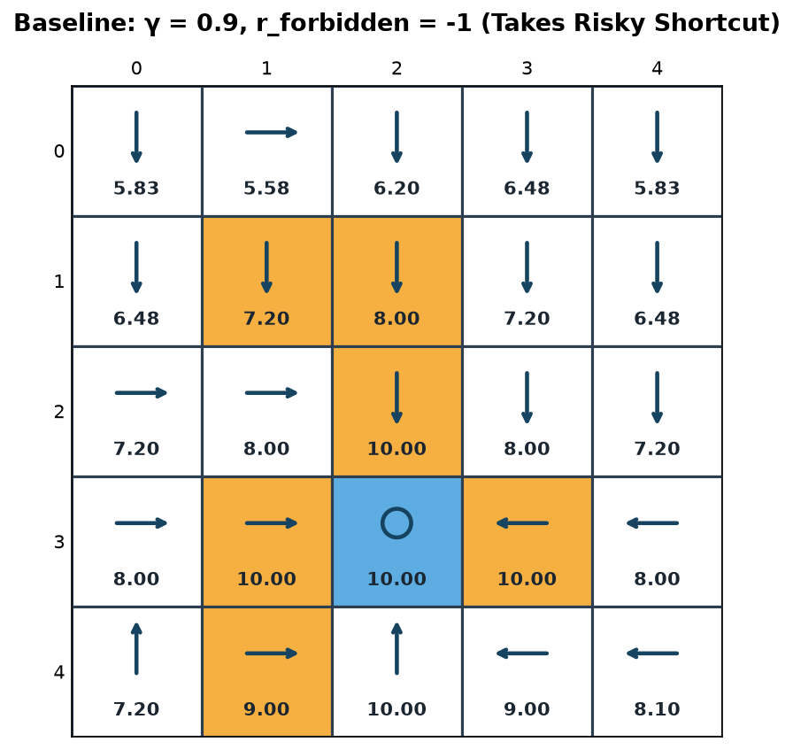
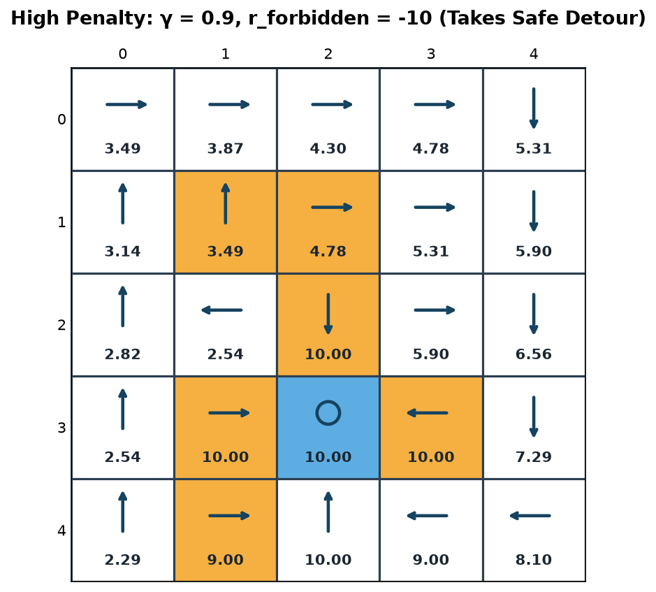
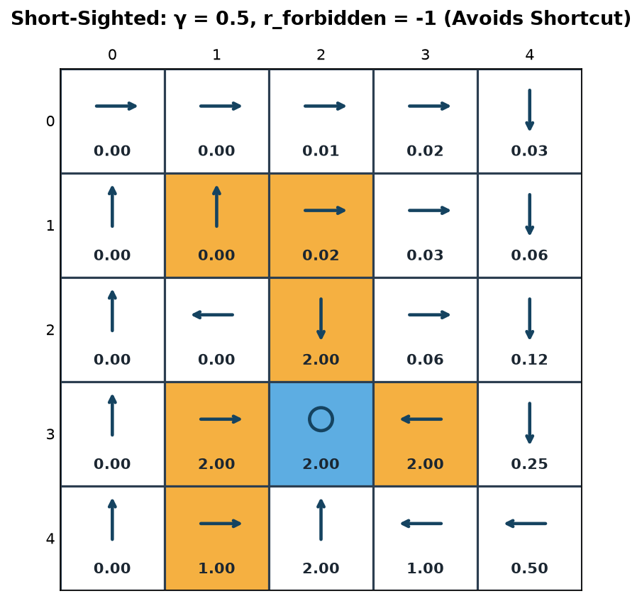
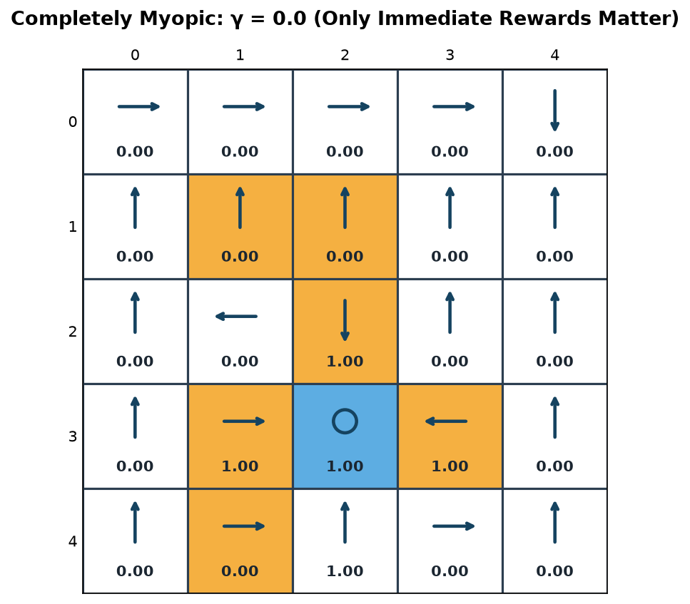

# 03. Optimal Policy Analysis (Factors Affecting $\pi^*$)

This module explores **Section 3.4** of *Mathematical Foundations of Reinforcement Learning* by Shiyu Zhao, analyzing how reward structures and discount rates shape the optimal state values ($v^*$) and optimal policy ($\pi^*$) in the 5×5 Grid World environment.

## Experiments Included (`optimal_policy_factors.py`)

1. **Baseline ($\gamma = 0.9,\ r_{\text{forbidden}} = -1$):**
   The forbidden cell penalty is small enough that the optimal policy takes a risky shortcut through forbidden cells to reach the target faster.
2. **High Forbidden Penalty ($\gamma = 0.9,\ r_{\text{forbidden}} = -10$):**
   Increasing the penalty forces the agent to avoid forbidden cells completely and take a longer, safe detour.
3. **Discount Rate Sensitivity ($\gamma = 0.5$ and $\gamma = 0.0$):**
   Decreasing $\gamma$ makes the agent increasingly short-sighted—at $\gamma = 0.0$, future rewards are ignored completely and only immediate rewards dictate the policy.
4. **Positive Affine Reward Transformation Invariance:**
   Numerically verifies the theorem that transforming all rewards via $r' = a r + b$ ($a > 0$) scales and shifts the optimal state values as:
   $$v'^* = a v^* + \frac{b}{1 - \gamma}\mathbf{1}$$
   while leaving the optimal policy completely unchanged ($\pi'^* = \pi^*$).

## Visual Results

| Baseline ($\gamma = 0.9,\ r_{\text{forbidden}} = -1$) | High Penalty ($\gamma = 0.9,\ r_{\text{forbidden}} = -10$) |
| :---: | :---: |
|  |  |

| Short-Sighted ($\gamma = 0.5$) | Completely Myopic ($\gamma = 0.0$) |
| :---: | :---: |
|  |  |

## Usage
Run from the repository root:
```bash
python 03_Optimal_Policy_Analysis/optimal_policy_factors.py
```